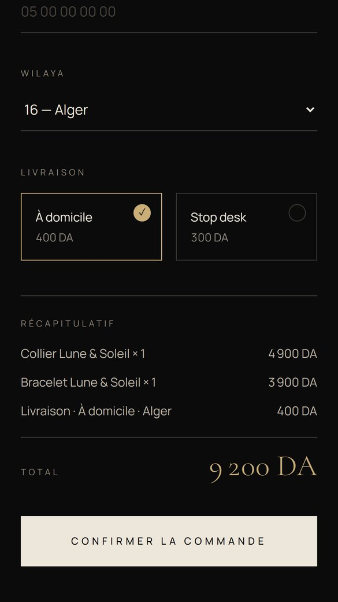

# Orléa Jewels — Collection Lune & Soleil

Landing page e-commerce pour une marque de bijoux, pensée pour la vente en paiement à la livraison (COD) en Algérie.

**Site en ligne :** https://orlea-demo.vercel.app

<p>
  
  
  
</p>

## Fonctionnalités

- **Hero animé** : la lune et le soleil s'ouvrent au défilement, sur fond nuit / jour avec des étoiles scintillantes.
- **Collection** : deux produits (collier et bracelet) avec photo principale, photos de détail et prix en DA.
- **Commande COD** : formulaire nom, téléphone, wilaya (les 58), livraison à domicile ou au bureau, quantités par produit, frais de livraison et total calculés en direct.
- **Validation côté serveur** (Server Action) et confirmation par toast.
- **Bouton de commande flottant** qui mène au formulaire.
- Mobile-first, animations sur `transform` / `opacity` ; les animations d'ambiance sont coupées si `prefers-reduced-motion`.

> Les commandes sont validées puis journalisées côté serveur. L'envoi vers Google Sheets n'est pas encore branché (voir `app/actions.ts`).

## Stack

- [Next.js 16](https://nextjs.org) (App Router, Server Components, Server Actions)
- React 19 + TypeScript
- Tailwind CSS 4 + shadcn/ui (Base UI)
- [Motion](https://motion.dev) pour les animations
- [Sonner](https://sonner.emilkowal.ski) pour les toasts
- Playwright pour les captures (`scripts/screenshots.mjs`)
- Déploiement sur Vercel

## Lancer en local

Prérequis : Node.js 20 ou plus.

```bash
npm install
npm run dev
```

Puis ouvrir http://localhost:3000.

Build de production :

```bash
npm run build
npm start
```

## Structure

```
app/            page, layout, Server Action de commande
components/     Hero, Collection, formulaire de commande, CTA flottant
src/content.ts  textes, produits et prix
src/data/       wilayas et frais de livraison
src/order.ts    validation et calcul des totaux
```

## Auteur

Mahfoud — SM_code.dev
